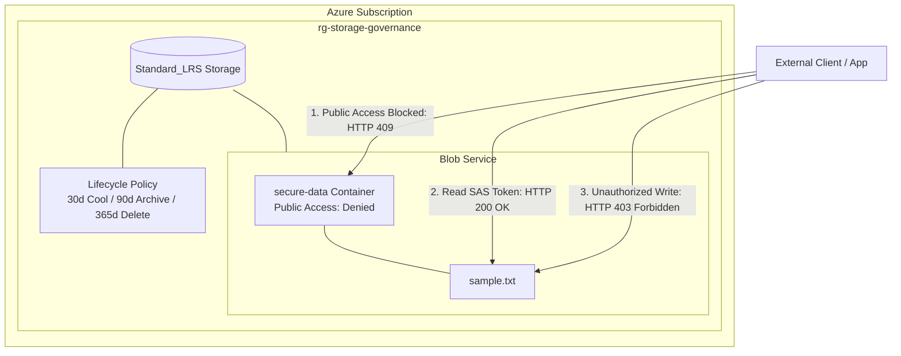

# Secure Cloud Storage Automation and SAS Governance Pipeline

## Overview
This project implements an automated, secure cloud storage architecture deployed via Azure Bicep. It establishes resource-level security guardrails, automated data tiering policies, and delegated access controls without requiring tenant-level administrative privileges.

## Architecture

